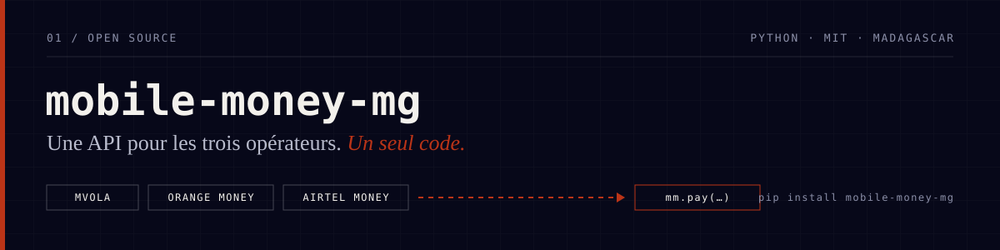
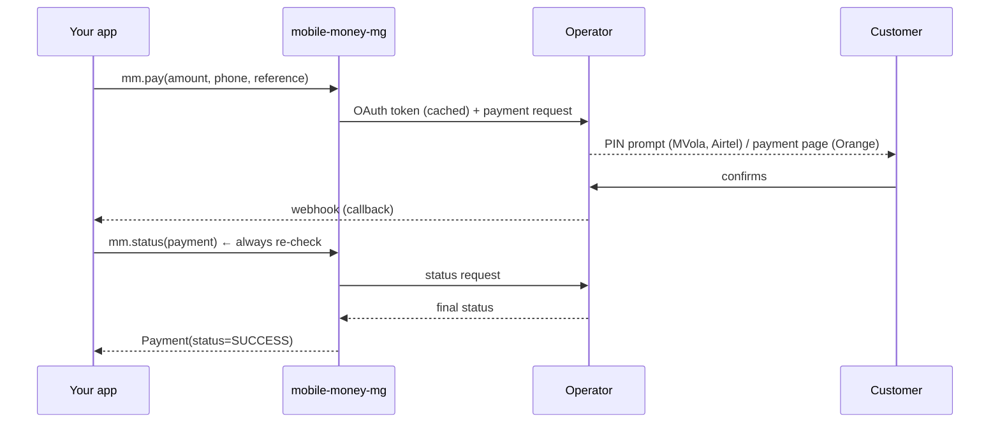

<p align="center">
  
</p>

<p align="center">
  <a href="https://github.com/finaritrak/mobile-money-mg/actions/workflows/ci.yml"></a>
  
  
  
  
</p>

<p align="center"><b>Accept MVola, Orange Money and Airtel Money payments in Madagascar with one Python API.</b><br>
Payments, status, webhooks, phone-number handling, and an offline simulator so you can build your checkout before you even have credentials.</p>

<p align="center"><a href="#-en-français">🇫🇷 Lire en français</a></p>

---

## Why

Every Malagasy operator has its own authentication, its own payload, its own status codes and its own callback format. Integrating all three usually means three half-finished scripts copied from forum posts.

`mobile-money-mg` gives you **one interface**:

```python
from mobile_money_mg import MobileMoney

mm = MobileMoney.from_env()

payment = mm.pay(amount=15000, phone="034 12 345 67", reference="CMD-1042")
#            ↑ operator detected from the prefix: 034/038 MVola · 032/037 Orange · 033 Airtel

payment = mm.wait(payment)  # or use webhooks (recommended)
if payment.is_paid:
    deliver_order()
```

| | MVola | Orange Money | Airtel Money |
|---|:---:|:---:|:---:|
| Start a payment | ✅ USSD push | ✅ payment page | ✅ USSD push |
| Check status | ✅ | ✅ | ✅ |
| Parse webhooks | ✅ | ✅ + `notif_token` check | ✅ |
| Sandbox / production switch | ✅ | ✅ | ✅ |
| Normalised status | `pending` · `success` · `failed` · `expired` · `unknown` |||

## Install

```bash
pip install mobile-money-mg
```

The only dependency is [`httpx`](https://www.python-httpx.org/). Python 3.9+.

## Try it in 10 seconds (no account needed)

```bash
python -m mobile_money_mg
```

```text
mobile-money-mg 0.1.0 — simulator demo (no network, no credentials)

  DEMO-1  034 12 345 67    mvola          10,000 Ar  →  SUCCESS  Paiement reçu (simulation)
  DEMO-2  032 98 765 13    orange_money   20,000 Ar  →  FAILED   Solde insuffisant (simulation)
  DEMO-3  033 11 222 98    airtel_money   30,000 Ar  →  EXPIRED  Délai de confirmation dépassé (simulation)
```

The simulator is a full provider. Use `MobileMoney.sandbox()` (or `MOBILE_MONEY_SIMULATOR=1`) in your tests and local development. The outcome depends on the last two digits of the number:

| Number ends with | Result |
|---|---|
| `…13` | `failed` (insufficient balance) |
| `…98` | `expired` |
| `…99` | stays `pending` (to test your timeouts) |
| anything else | `success` |

## How a payment works



## Configuration

### From environment variables

```python
mm = MobileMoney.from_env()  # only the operators whose variables are set are enabled
```

See [`.env.example`](.env.example) for the complete list (`MVOLA_*`, `ORANGE_*`, `AIRTEL_*`). Set `MOBILE_MONEY_PRODUCTION=true` to leave the sandboxes.

### In code

```python
from mobile_money_mg import MobileMoney, MVola, OrangeMoney, AirtelMoney

mm = MobileMoney(
    mvola=MVola(
        consumer_key="…",
        consumer_secret="…",
        merchant_number="034 35 000 04",
        partner_name="MyShop",
        callback_url="https://myshop.mg/webhooks/mvola",
        sandbox=True,
    ),
    orange=OrangeMoney(
        authorization_header="Basic …",  # shown in your Orange Developer app
        merchant_key="…",
        return_url="https://myshop.mg/paid",
        cancel_url="https://myshop.mg/cancelled",
        notif_url="https://myshop.mg/webhooks/orange_money",
        sandbox=True,
    ),
    airtel=AirtelMoney(client_id="…", client_secret="…", sandbox=True),
)
```

You can also use a provider on its own: `MVola(...).initiate_payment(...)`.

## Webhooks: the safe way

Anyone can POST to a public URL. **Never deliver an order on a callback alone.** Parse it, find the payment, then ask the operator:

```python
@app.api_route("/webhooks/{operator}", methods=["POST", "PUT"])  # MVola uses PUT
async def webhook(operator: Operator, request: Request):
    event = mm.parse_webhook(operator, await request.body())
    payment = find_payment(event)  # by event.provider_id / event.reference / notif_token
    payment = mm.status(payment)  # ← source of truth
    if payment.is_paid:
        mark_order_as_paid(payment.reference)
```

For Orange Money, also pass the token you stored when the payment started:
`mm.parse_webhook("orange_money", body, expected_notif_token=payment.notif_token)`. It is compared in constant time.

Complete, runnable examples: [FastAPI](examples/fastapi_app.py) · [Django](examples/django_views.py) · [script](examples/quickstart.py).

## Orange Money is different

Orange Money Web Payment is a **redirect** flow: `mm.pay()` returns `payment.redirect_url`. Send the customer there. They confirm with a one-time code from the Orange Money USSD menu, then come back to your `return_url`. The `phone` argument is optional for Orange.

## Errors

Every exception inherits from `MobileMoneyError`:

| Exception | When |
|---|---|
| `ConfigurationError` | missing credentials or settings |
| `InvalidPhoneNumber` | not a Malagasy mobile number |
| `UnsupportedOperator` | no provider configured for this prefix |
| `AuthenticationError` | operator refused the credentials (the cached token is cleared automatically) |
| `ProviderError` | HTTP or business error. `.status_code` and `.payload` hold the details |
| `WebhookError` | malformed or forged callback |

## Phone numbers

```python
from mobile_money_mg import normalize, detect_operator

normalize("+261 34 12 345 67")  # '0341234567'
detect_operator("032 12 345 67")  # Operator.ORANGE_MONEY
```

## Going to production: checklist

- [ ] Get production credentials from each operator (a merchant account and KYC are required).
- [ ] Run your full flow in each **sandbox** first. The MVola sandbox uses `0343500003` / `0343500004`.
- [ ] Use unique `reference` values (your order IDs). Operators reject duplicates.
- [ ] Expose HTTPS callback URLs and re-check the status before delivering.
- [ ] Store `provider_id` (and `notif_token` for Orange) with each order.
- [ ] Never log tokens, secrets or full customer numbers.

> **Note.** This library is not affiliated with Telma/MVola, Orange or Airtel. Endpoints and payloads follow the operators' developer documentation, and everything can be overridden (`base_url`, `token_path`, …) if an operator changes its API. Please [open an issue](https://github.com/finaritrak/mobile-money-mg/issues) if something has moved.

## Roadmap

- [ ] Async client (`httpx.AsyncClient`)
- [ ] Refunds and disbursements (payouts)
- [ ] Node.js / TypeScript version
- [ ] More countries: Airtel and Orange operate across Africa

## Contributing

PRs welcome. See [CONTRIBUTING.md](CONTRIBUTING.md). `pytest`, `ruff` and `mypy --strict` run on every push.

---

## 🇫🇷 En français

**`mobile-money-mg`** permet d'accepter **MVola, Orange Money et Airtel Money** avec une seule API Python : lancer un paiement, suivre son statut et recevoir les webhooks en toute sécurité. Il inclut aussi un **simulateur hors ligne** pour développer sans compte marchand.

```bash
pip install mobile-money-mg
python -m mobile_money_mg          # démo instantanée, sans identifiants
```

```python
mm = MobileMoney.from_env()
paiement = mm.pay(amount=15000, phone="034 12 345 67", reference="CMD-1042")
paiement = mm.wait(paiement)
if paiement.is_paid:
    livrer_la_commande()
```

- L'opérateur est **détecté automatiquement** grâce au préfixe : 034/038 → MVola, 032/037 → Orange Money, 033 → Airtel Money.
- Les numéros sont **acceptés dans tous les formats** : `034 12 345 67`, `+261…`, `261…`.
- Le webhook est **vérifié** : le SDK revérifie toujours le statut auprès de l'opérateur avant de valider.
- Le paquet est **testé** (plus de 95 % de couverture), **typé** et sous **licence MIT**.

Questions, bugs ou contributions : ouvrez une *issue*, en français ou en anglais.

---

<p align="center"><sub>Built in Antananarivo by <a href="https://finaritra.katonne.com">Aina Finaritra Rakotonindrainy</a> · <a href="https://katonne.com">Katonne</a> — <i>du capteur terrain à la décision.</i></sub></p>
